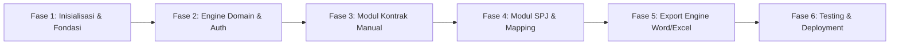

# PRODUCT REQUIREMENTS DOCUMENT (PRD)
## Rebuild Sistem Pengelolaan SPJ & Kontrak Pengadaan Langsung (Bapenda Jember)
**Target Stack:** Next.js (App Router), TypeScript, Tailwind CSS, SQLite / PostgreSQL  
**Versi Dokumen:** 1.0.0  
**Tanggal:** 20 November 2026  
**Status:** Ready for Implementation  

---

## 1. Executive Summary & Latar Belakang

### 1.1 Ringkasan Produk
Aplikasi **SPJ & Kontrak Manual Terpadu** adalah sistem administrasi belanja daerah dan pengadaan langsung yang digunakan oleh Badan Pendapatan Daerah (Bapenda) Kabupaten Jember. Aplikasi ini mengelola siklus hidup pengadaan barang/jasa langsung (nilai belanja di bawah Rp 200 juta), mulai dari penetapan HPS, proses negosiasi, penerbitan SPK, hingga otomatisasi pembentukan berkas Surat Pertanggungjawaban (SPJ) keuangan, kuitansi, berita acara pemeriksaan/serah terima, dan rekapitulasi realisasi belanja ke format Word (`.docx`) dan Excel (`.xlsx`).

### 1.2 Masalah pada Sistem Legacy (`old_references` v2.0.0)
Berdasarkan audit teknis terhadap folder `old_references`, ditemukan beberapa batasan struktural:
1. **Arsitektur Monolitik Iframe Bersarang:**  
   Versi 2 menyatukan dua SPA lawas (SPJ dan Kontrak) dengan cara menyematkan seluruh kode HTML/JS modul (masing-masing >120 KB dan >160 KB kode terkompilasi) ke dalam string Base64 di dalam berkas tunggal `public/index.html` dan memuatnya melalui elemen `<iframe>`. Komunikasi antar-modul mengandalkan jembatan `window.ModuleHost` yang rapuh dan sulit didebug.
2. **Ketiadaan Komponen UI Modular & Type Safety:**  
   Tidak ada komponen reusable berbasis React/TypeScript. Formulir yang kompleks (SPJ memiliki 72 field, Kontrak memiliki 22 field tanggal dan tabel RAB multi-kelompok) ditulis menggunakan manipulasi DOM langsung (`document.getElementById`).
3. **Penyusunan Berkas di Browser (Client-side Document Assembly):**  
   Penyusunan berkas Word (`.docx`) dan Excel (`.xlsx`) dilakukan di sisi peramban klien dengan memanipulasi string XML OpenXML (`word/document.xml`, `customXml/item2.xml`, `xl/worksheets/sheet1.xml`) secara manual menggunakan DOMParser dan JSZip. Hal ini rawan kegagalan memori dan inkonsistensi antar-browser.
4. **Keterbatasan Skalabilitas Server:**  
   Server bawaan ditulis menggunakan `node:http` murni tanpa framework routing yang terstruktur, serta mengandalkan library SQLite internal yang terikat erat pada satu file instance tanpa migrasi skema formal.

### 1.3 Sasaran Pembaruan (Next.js Modern Architecture)
1. Membangun ulang seluruh antarmuka menjadi **Native Single-Application Next.js (App Router)** tanpa `iframe`.
2. Menerapkan **Type-Safe Domain Model** menggunakan TypeScript dan validasi skema runtime menggunakan Zod.
3. Mempertahankan 100% kompatibilitas aturan bisnis, formula perhitungan pajak (PPN & PPh), otomatisasi SPK ke SPJ, kontrol konkurensi optimistik (`revision`), serta format keluaran Word/Excel resmi Bapenda.
4. Menghadirkan antarmuka pengguna modern berstandar enterprise pemerintah: tipografi bersih, layout responsif dan berbobot fungsional tinggi, navigasi keyboard lengkap, serta visual hierarchy yang kokoh tanpa dekorasi buatan yang berlebihan.

---

## 2. Aktor Sistem & Peran (User Personas)

| Peran | Pengguna | Tanggung Jawab Utama | Hak Akses |
|---|---|---|---|
| **Admin** | Tim IT / Kasubag Keuangan & Perencanaan | - Manajemen akun pegawai (tambah, nonaktifkan, reset sandi, hapus).<br>- Akses ke seluruh dokumen pengadaan & SPJ semua staf.<br>- Melakukan ekspor rekapitulasi SPJ global ke format Excel.<br>- Mengimpor arsip lama (migrasi offline).<br>- Menjalankan dan memantau backup database. | Penuh (CRUD seluruh dokumen, akun, sistem, dan konfigurasi). |
| **User (Pegawai)** | PPTK, Pejabat Pengadaan, Staf Pembuat Dokumen | - Menginput data Kontrak Manual & menyusun RAB.<br>- Mencetak dokumen pengadaan (18 berkas Word & pratinjau cetak A4).<br>- Meneruskan Kontrak ke formulir SPJ secara otomatis.<br>- Melengkapi data pelaksanaan SPJ, tanggal, nomor berita acara, dan pejabat.<br>- Mengunduh berkas SPJ Word dan rekapitulasi pekerjaan pribadi.<br>- Mengubah profil dan kata sandi mandiri. | Terbatas pada dokumen yang dibuat sendiri (CRUD kepemilikan pribadi). |

---

## 3. Arsitektur Domain Bisnis

```
+----------------------------------------------------------------------------------------------------+
|                                    ALUR BISNIS BAPENDA JEMBER                                      |
+----------------------------------------------------------------------------------------------------+
|                                                                                                    |
|  [ MODUL 1: KONTRAK MANUAL PENGADAAN LANGSUNG ]                                                    |
|  1. Persiapan: Nota Dinas PPTK -> HPS -> Nota Dinas PPK -> Spesifikasi Teknis                      |
|  2. Undangan & Penawaran: Undangan -> Penawaran -> Minat -> Pakta Integritas                       |
|  3. Evaluasi & Negosiasi: BA Pembukaan -> BA Negosiasi Harga -> BAHPL -> BA Penetapan              |
|  4. Hasil & Kontrak: Pengumuman -> Penyampaian BA -> SPPBJ -> SPK (Surat Perintah Kerja)          |
|  Output: 18 Berkas Pengadaan (.docx) + Pratinjau Cetak A4                                          |
|                                                                                                    |
|                                        |                                                           |
|                                        | [ Meneruskan Kontrak ] (Auto Mapping)                     |
|                                        v                                                           |
|                                                                                                    |
|  [ MODUL 2: SPJ (SURAT PERTANGGUNGJAWABAN) ]                                                       |
|  1. Identitas & Nilai Tertaut: SPK, DPA, Rekening, Penyedia, Nilai Kontrak (Read-only)             |
|  2. RAB Tertaut: Item Belanja, QTY x Volume, Harga Negosiasi, PPN 11%                              |
|  3. Pelaksanaan Riil: Tanggal & Tempat Periksa, Hari, Waktu, Berita Acara (BAHP, BAST)              |
|  4. Rekening & Pejabat: Bank Jatim, Rekening, PA/PPK, PPTK, Bendahara, Pengurus Aset               |
|  5. Pajak: PPN & PPh (PPh 21 / PPh 22 [1.5%] / PPh 23 [2%] / PPh Final [0.5%]) -> Nilai Bersih    |
|  Output: Paket Berkas SPJ Lengkap (.docx) + Rekapitulasi SPJ Multi-Dokumen (.xlsx)                 |
|                                                                                                    |
+----------------------------------------------------------------------------------------------------+
```

---

## 4. Analisis Modul Referensi Lama & Aturan Bisnis

### 4.1 Modul Kontrak Manual (`contract-domain.mjs`)
Modul Kontrak Manual melayani pengadaan langsung barang/jasa pemerintah dengan rincian operasional:

1. **Struktur Data Dokumen:**
   - **Identitas Paket:** Nama paket, ruang lingkup pekerjaan, keterangan sampul, program, kegiatan, subkegiatan, kode rekening belanja (`5.1.02.xx.xx.xxxxx`), pagu anggaran (rupiah bulat), tahun anggaran, nomor & tanggal DPPA.
   - **Identitas Penyedia:** Bentuk badan usaha (`CV` atau `PT`), nama perusahaan (tanpa awalan CV/PT), alamat lengkap, NPWP penyedia, nomor telepon, nama penandatangan/wakil penyedia.
   - **Pejabat Pengadaan & PPK:** Nama & NIP PPK (perencanaan & SPK), Nama & NIP Pejabat Pengadaan.
   - **Jadwal & Tanggal (22 Variabel Tanggal):**
     * Validasi format tanggal `YYYY-MM-DD`.
     * Validasi urutan kronologis: `workEnd >= workStart`.
     * Perhitungan otomatis: Nama hari (`weekdayText`), format tanggal Indonesia (`dateText`), rentang periode kerja (`workPeriod`), dan teks ejaan terbilang tanggal panjang (contoh: *"Senin tanggal Dua bulan Oktober tahun Dua Ribu Dua Puluh Enam"*).
   - **RAB (Rencana Anggaran Biaya):**
     * Struktur hierarkis 2-tingkat: Kelompok RAB (1 s.d. 40 kelompok) dan Item RAB (1 s.d. 200 item).
     * Atribut per item: Uraian/nama, Satuan, Kuantitas/QTY (desimal), Volume (desimal), Harga Awal/HPS (rupiah bulat), Harga Negosiasi/Akhir (rupiah bulat, opsional dengan fallback ke harga awal).
     * Perhitungan:  
       $$\text{Nilai Awal Item} = \text{round}\left(\frac{\text{QTY} \times \text{Volume} \times \text{Harga Awal}}{1}\right)$$  
       $$\text{Nilai Akhir Item} = \text{round}\left(\frac{\text{QTY} \times \text{Volume} \times \text{Harga Akhir}}{1}\right)$$
     * Perhitungan Pajak: PPN tarif standar (default 11%, mendukung tarif desimal 0–100%).
     * Batas keamanan nilai: Maksimal Rp 999.999.999.999.999 (999 triliun).
     * Konversi terbilang otomatis (`rupiahWords`) dengan format baku huruf kapital judul (contoh: *"Sembilan Puluh Sembilan Juta Lima Ratus Tiga Puluh Sembilan Ribu Dua Ratus Lima Puluh Rupiah"*).

2. **Daftar Berkas Pengadaan yang Dihasilkan (18 Berkas):**
   - **Grup 1 - Persiapan dan Undangan:**
     1. Nota Dinas PPTK kepada PPK
     2. Harga Perkiraan Sendiri (HPS)
     3. Nota Dinas PPK kepada Pejabat Pengadaan
     4. Penetapan Spesifikasi Teknis
     5. Undangan Pengadaan Langsung
     6. Jadwal Pemasukan Dokumen Penawaran
     7. Jadwal Klarifikasi Teknis dan Negosiasi Harga
   - **Grup 2 - Surat Penyedia dan Berita Acara:**
     8. Surat Penawaran Harga
     9. Surat Pernyataan Minat
     10. Pakta Integritas
     11. Berita Acara Pembukaan Penawaran
     12. Berita Acara Klarifikasi dan Negosiasi Harga
     13. Berita Acara Hasil Pengadaan Langsung (BAHPL)
     14. Berita Acara Penetapan Pemenang Penyedia
   - **Grup 3 - Hasil Pengadaan dan Kontrak:**
     15. Pengumuman Hasil Pengadaan Langsung
     16. Nota Dinas Penyampaian BA Proses Pengadaan
     17. Surat Penunjukan Penyedia Barang/Jasa (SPPBJ)
     18. Surat Perintah Kerja (SPK)

3. **Mekanisme Pembangkitan Dokumen Word Kontrak:**
   - Memakai basis master template `.docx` (disimpan dalam `templates/kontrak.json`).
   - Menerapkan **Paragraph Plan**: Penggantian teks presisi pada tingkat `run` XML (`<w:t>`) berdasarkan index paragraf dan offset karakter (`start`, `end`, `case: "upper"|"lower"`).
   - Menerapkan **Table Plan**: Mengkloning baris contoh tabel pada 7 posisi tabel dokumen Word (HPS, BA Negosiasi, BAHPL, BA Penetapan, Pengumuman, Nota Penyampaian, dan SPK) serta menyuntikkan baris kelompok dan item secara dinamis.

---

### 4.2 Modul SPJ (`templates/spj.json`, `money.mjs`)
Modul SPJ melayani administrasi pencairan anggaran dan pertanggungjawaban belanja:

1. **Struktur Data Dokumen (72 Fields Terstandar):**
   - **Kelompok Kegiatan (8 Field):** `pekerjaan`, `program`, `kegiatan`, `sub_kegiatan`, `kode_rekening`, `tahun_anggaran`, `bagian_bulan`, `nomor_dpa`.
   - **Kelompok Tanggal (19 Field):** `tanggal_dpa`, `sk_pa_tanggal`, `sk_pptk_tanggal`, `sk_aset_tanggal`, `tanggal_sp`, `tanggal_selesai`, `tanggal_selesai_angka`, `tanggal_penyerahan`, `tanggal_periksa`, `tanggal_periksa_angka`, `hari_periksa`, `jam_periksa`, `tempat_periksa`, `tanggal_terima_barang`, `tanggal_permohonan_bayar`, `tanggal_bapp`, `tanggal_ringkasan`, `tanggal_kuitansi`, `tanggal_nota_cair`.
   - **Kelompok Penyedia (9 Field):** `nama_penyedia`, `bentuk_usaha`, `alamat_penyedia`, `wakil_penyedia`, `jabatan_penyedia`, `jabatan_penyedia_bayar`, `bank`, `rekening_bank`, `npwp`.
   - **Kelompok Keuangan (10 Field):** `satuan`, `volume`, `harga_satuan`, `nilai_total`, `terbilang_total`, `ppn`, `pph23` (atau variasi PPh terpilih), `nilai_bersih`, `jangka_waktu`, `masa_pemeliharaan`.
   - **Kelompok Nomor Surat (6 Field):** `nomor_sp`, `nomor_bap_adm`, `nomor_bahp`, `nomor_bast_ppk`, `nomor_bast_aset`, `nomor_bapp`.
   - **Kelompok Pejabat (12 Field):** `nama_pa`, `nip_pa`, `pangkat_pa`, `nama_pptk`, `nip_pptk`, `pangkat_pptk`, `nama_bendahara`, `nip_bendahara`, `pangkat_bendahara`, `nama_aset`, `nip_aset`, `pangkat_pptk_kuitansi`.
   - **Kelompok Penetapan SK (3 Field):** `sk_pa_nomor`, `sk_pptk_nomor`, `sk_aset_nomor`.
   - **Kelompok Terbilang Tanggal Huruf (5 Field):** `uraian_tanggal_adm`, `uraian_tanggal_periksa`, `uraian_tanggal_bast_ppk`, `uraian_tanggal_bast_aset`, `uraian_tanggal_bapp`.

2. **Rincian Belanja SPJ:**
   - Array item (1 s.d. 200 baris): `description`, `detail`, `unit`, `quantity`, `unitPrice`.

3. **Formula Perhitungan Keuangan & Perpajakan SPJ (`money.mjs`):**
   - **Basis Harga:**
     * `excluded`: Harga belum termasuk PPN.  
       $$\text{DPP} = \sum (\text{Qty} \times \text{Harga Satuan})$$  
       $$\text{PPN} = \text{round}\left(\frac{\text{DPP} \times \text{Tarif PPN}}{100}\right)$$  
       $$\text{Total Bruto} = \text{DPP} + \text{PPN}$$
     * `included`: Harga sudah termasuk PPN.  
       $$\text{Total Bruto} = \sum (\text{Qty} \times \text{Harga Satuan})$$  
       $$\text{PPN} = \text{round}\left(\frac{\text{Total Bruto} \times \text{Tarif PPN}}{100 + \text{Tarif PPN}}\right)$$  
       $$\text{DPP (Dasar Pengenaan Pajak)} = \text{Total Bruto} - \text{PPN}$$
   - **Pajak Penghasilan (PPh):**
     * Opsi PPh: `none`, `pph21` (Pegawai/Narasumber), `pph22` (Barang, 1.5%), `pph23` (Jasa/Sewa, 2.0%), `pph_final` (0.5% UMKM atau tarif khusus).
     * Dasar Pengenaan PPh dihitung terhadap DPP (sebelum PPN).  
       $$\text{Potongan PPh} = \text{round}\left(\frac{\text{DPP} \times \text{Tarif PPh}}{100}\right)$$
   - **Nilai Diterima Bersih (Netto):**  
     $$\text{Nilai Bersih} = \text{Total Bruto} - \text{Potongan PPN} - \text{Potongan PPh}$$

4. **Pembangkitan Dokumen SPJ:**
   - **Format Word (.docx):** Menggunakan teknik OpenXML **XML Data Binding** (`customXml/item2.xml`) dengan namespace `urn:bapenda:spj:offline:v1` dan ID Store `{FBBECCC2-90F9-44CC-B7DF-834C99B0809F}`. Nilai field dan perulangan item disuntikkan ke dalam node XML data binding.
   - **Format Rekapitulasi Excel (.xlsx):** Berdasarkan template `reportTemplateBase64` di `templates/spj.json`. Menghasilkan file Excel rekap multi-dokumen dengan format baris tabel dinamis, nomor urut, uraian rekening, kode kegiatan, rekanan/penyedia, nilai bruto, PPN, PPh, nilai netto, dan nomor SPK.

---

### 4.3 Pipeline Integrasi Kontrak ke SPJ (`link-service.mjs`)
Fitur integrasi merupakan inti keunggulan sistem ini:

1. **Pemetaan Otomatis (Mapping Matrix):**

| Field SPJ | Sumber dari Kontrak Manual | Transformasi / Format |
|---|---|---|
| `pekerjaan` | `packageName` | String langsung |
| `nama_penyedia` | `providerName` | Menghilangkan prefix PT/CV |
| `bentuk_usaha` | `providerType` | Menambahkan titik (`CV.` / `PT.`) |
| `alamat_penyedia` | `address` | String langsung |
| `npwp` | `npwp` | Format NPWP |
| `wakil_penyedia` | `signatory` | String langsung |
| `nomor_sp` | `spkNumber` | Disalin lengkap |
| `tanggal_sp` | `spkDate` | Format tanggal Indonesia |
| `nomor_dpa` | `dppaNumber` | String langsung |
| `tanggal_dpa` | `dppaDate` | Format tanggal Indonesia |
| `sub_kegiatan` | `subactivity` | String langsung |
| `kegiatan` | `activity` | String langsung |
| `program` | `program` | String langsung |
| `kode_rekening` | `accountCode` | String langsung |
| `tahun_anggaran` | `fiscalYear` | 4 digit tahun |
| `bagian_bulan` | `paymentMonth` + `fiscalYear` | Contoh: "Oktober 2026" |
| `nama_pa` | `ppkName` | String langsung |
| `nip_pa` | `ppkSpkNip` | NIP PPK pada SPK |
| `tanggal_selesai` | `workEnd` | Format tanggal Indonesia |
| `jangka_waktu` | Selisih `workStart` s.d. `workEnd` + 1 | Dihitung dalam hari (contoh: "3") |
| `price_basis` | - | Otomatis diatur `"excluded"` |
| `ppn` / `ppn_rate`| `vatRate` | Tarif PPN dari kontrak (11%) |
| **RAB Items** | `groups[].items[]` | Datar (flatten):<br>- `quantity` = `item.quantity` × `item.volume`<br>- `unitPrice` = `item.finalPrice` \|\| `item.earlyPrice`<br>- `detail` = `Group Name · QTY X × Vol Y` |

2. **Snapshot & Deteksi Kontrak Berubah (Source Stale Detection):**
   - SPJ menyimpan snapshot metadata kontrak sumber (`source.id`, `source.revision`, `spk`, `subtotal`, `ppn`, `total`).
   - Setiap kali SPJ dimuat, sistem mengecek revisi terkini dari kontrak sumber:
     * `current`: Kontrak sumber identik dengan revisi saat SPJ dibuat.
     * `changed`: Kontrak sumber telah diedit/memiliki revisi baru. SPJ diberi status peringatan **"Sumber diperbarui"**. Tombol cetak Word **dikunci** (HTTP 409 `source-stale`) sampai pengguna menekan tombol **"Perbarui dari kontrak"** dan menyimpannya.
     * `deleted`: Kontrak sumber telah dihapus. SPJ tetap aman dan dapat diedit karena menyimpan snapshot beku (freeze snapshot), mencegah *orphan data* atau data hilang.
   - Field yang tertaut bersifat *read-only* pada form SPJ selama statusnya terhubung, mencegah inkonsistensi data pengadaan dan pencairan.

---

### 4.4 Mekanisme Keamanan & Konkurensi (`store.mjs`, `security.mjs`)

1. **Optimistic Concurrency Control (OCC):**
   - Setiap dokumen memiliki field integer `revision` yang bertambah 1 setiap kali ada modifikasi.
   - Permintaan simpan (`PUT`), hapus (`DELETE`), dan ekspor (`POST /export`) wajib menyertakan header `If-Match: "<revision>"`.
   - Jika dokumen telah diedit oleh sesi lain atau pengguna lain di waktu bersamaan, server mengembalikan status **HTTP 412 Precondition Failed (`stale`)**.
   - Klien tidak boleh me-refresh halaman yang menyebabkan hilangnya ketikan pengguna. Klien harus menawarkan **"Cadangkan isian ke JSON lokal"** sebelum memuat versi terbaru dari server.

2. **Audit Trail & Event Log:**
   - Tabel `events` mencatat setiap aksi: `created`, `edited`, `deleted`, `imported`.
   - Mencatat aktor (`actor_id`, `actor_name`), waktu ISO 8601, nomor urut sekuensial, dan penanda data warisan (`legacy`).

3. **Keamanan Autentikasi:**
   - Password hashing: **Scrypt** (`N=32768, r=8, p=3`) dengan salt acak 16 byte. Kata sandi minimal 12 karakter.
   - Session management: Token acak 32-byte base64url disimpan dalam bentuk SHA-256 hash di database dan disajikan melalui cookie aman `bapenda_session` (`HttpOnly`, `SameSite=Strict`, `Secure` pada mode HTTPS).
   - Masa berlaku sesi: 8 jam.
   - Proteksi CSRF: Menggunakan token unik `csrf` per sesi yang wajib dikirimkan pada header `X-CSRF-Token` pada seluruh permintaan non-GET.
   - Rate Limiting:
     * Login: Maksimal 8 percobaan gagal per akun dalam 5 menit, dan maksimal 120 percobaan per IP dalam 5 menit.
     * Ubah password: Maksimal 8 percobaan per akun dalam 5 menit.
   - Origin Checking: Memvalidasi header `Origin` terhadap domain resmi kantor.

4. **Migrasi Arsip Offline (`legacy-import.mjs`):**
   - Mendukung impor arsip batch JSON hingga 3.000 dokumen atau ukuran berkas 20 MB.
   - Format didukung: `SPJ_REKAP_OFFLINE` (v1 & v2) dan `BAPENDA_KONTRAK_ARSIP_OFFLINE` (v1).
   - Validasi kepemilikan akun: Dokumen lama wajib memiliki padanan akun di database sebelum diimpor.
   - Deteksi duplikasi & konflik berbasis hash SHA-256: Dokumen identik dilewati (`skipped`), perbedaan isi pada ID yang sama dilaporkan sebagai konflik (`conflicts`).

---

## 5. Rencana Arsitektur Next.js Modern (Target Rebuild)

### 5.1 Tech Stack Pilihan

| Layer | Teknologi | Alasan Pemilihan |
|---|---|---|
| **Framework** | **Next.js 15+ (App Router)** | Full-stack framework dengan Server Components, Route Handlers, dan Server Actions yang handal. |
| **Bahasa** | **TypeScript 5.x** | Enforcing strict type safety untuk 72 field SPJ, struktur hierarkis RAB, dan payload kalkulasi. |
| **Styling & UI** | **Tailwind CSS v4 + Radix UI / shadcn/ui** | Desain yang bersih, modular, mudah disesuaikan dengan tema lokal, serta aksesibel (WCAG AA). |
| **Database & ORM** | **SQLite (via Prisma atau Drizzle ORM)** | Mempertahankan arsitektur zero-maintenance database berkas tunggal (`bapenda.sqlite`) yang mudah dibackup, atau opsi PostgreSQL jika ingin multi-server. |
| **Form Management** | **React Hook Form + Zod** | Performa rendering cepat pada form besar (72 field), validasi instan, dan integrasi tipe Zod. |
| **Manajemen Dokumen** | **Docx / PizZip + Docxtemplater** atau modul **OpenXML builder** | Pembangkitan file `.docx` di server (Server Action / API Route) yang stabil tanpa membebani browser klien. |
| **Pembangkitan Excel** | **ExcelJS** | Menggantikan manipulasi string XML mentah dengan API objek Excel yang tangguh dan teruji. |
| **Autentikasi** | **Auth.js (NextAuth v5)** atau **Custom Session via Jose / Node Crypto** | Menjaga kompatibilitas dengan skema tabel akun, cookie HttpOnly, dan audit log sesi yang sudah ada. |

### 5.2 Struktur Proyek Rekomendasi (Next.js App Router)

```
aplikasi-spj/
├── docs/
│   ├── PRD.md                       # Dokumen Spesifikasi Produk ini
│   └── API_SPEC.md                  # Spesifikasi detail endpoint & skema
├── old_references/                  # Referensi program lama (v2.0.0)
├── src/
│   ├── app/
│   │   ├── (auth)/
│   │   │   └── login/page.tsx       # Halaman login modern
│   │   ├── (dashboard)/
│   │   │   ├── layout.tsx           # Layout utama: Topbar, Sidebar, Theme Provider
│   │   │   ├── page.tsx             # Dashboard ringkasan & daftar dokumen gabungan
│   │   │   ├── kontrak/
│   │   │   │   ├── page.tsx         # Daftar Kontrak Manual & filter
│   │   │   │   ├── baru/page.tsx    # Formulir input Kontrak Manual baru
│   │   │   │   └── [id]/
│   │   │   │       ├── edit/page.tsx # Edit Kontrak Manual
│   │   │   │       └── cetak/page.tsx# Pratinjau Cetak Kontrak A4
│   │   │   ├── spj/
│   │   │   │   ├── page.tsx         # Daftar SPJ & tombol Rekap Excel
│   │   │   │   ├── baru/page.tsx    # Dialog pilihan SPJ Baru / Teruskan Kontrak
│   │   │   │   └── [id]/
│   │   │   │       └── edit/page.tsx# Formulir 72 field SPJ & Rincian Belanja
│   │   │   ├── admin/
│   │   │   │   ├── akun/page.tsx    # Kelola Akun (Admin only)
│   │   │   │   └── migrasi/page.tsx # Impor Arsip Offline (Admin only)
│   │   │   └── profil/page.tsx      # Profil Pengguna & Ganti Password
│   │   ├── api/
│   │   │   ├── auth/[...nextauth]/route.ts
│   │   │   ├── export/
│   │   │   │   ├── word/[app]/[id]/route.ts  # Endpoint download Word Kontrak / SPJ
│   │   │   │   └── excel/spj/route.ts        # Endpoint download Rekap SPJ Excel
│   │   │   └── backup/route.ts
│   │   └── layout.tsx
│   ├── components/
│   │   ├── ui/                      # Base UI: Button, Input, Select, Dialog, Card, Table
│   │   ├── dashboard/               # Widget stat, filter bar, tabel dokumen
│   │   ├── forms/
│   │   │   ├── contract-form/       # Subkomponen form kontrak (Identitas, Jadwal, RAB)
│   │   │   ├── spj-form/            # Subkomponen form SPJ (Kegiatan, Penyedia, Pajak, Pejabat)
│   │   │   └── rab-table.tsx        # Tabel dinamis RAB (kelompok & baris item)
│   │   ├── layout/                  # Sidebar, Topbar, ProfileMenu, ThemeSwitcher
│   │   └── common/                  # Badge status, ConcurrencyAlert, UnsavedChangesModal
│   ├── lib/
│   │   ├── db/                      # Koneksi SQLite & skema (Drizzle / Prisma)
│   │   ├── domain/
│   │   │   ├── contract-calc.ts     # Logika kalkulasi RAB, terbilang, tanggal (dari contract-domain.mjs)
│   │   │   ├── tax-calc.ts          # Logika kalkulasi PPN & PPh (dari money.mjs)
│   │   │   ├── link-mapper.ts       # Mapping Kontrak -> SPJ & verifikasi status snapshot
│   │   │   └── terbilang.ts         # Library terbilang angka & tanggal bahasa Indonesia
│   │   ├── exporters/
│   │   │   ├── word-contract.ts     # Pembangkit berkas Word Kontrak (18 surat)
│   │   │   ├── word-spj.ts          # Pembangkit berkas Word SPJ (customXml binding)
│   │   │   └── excel-spj.ts         # Pembangkit berkas Excel Rekapitulasi SPJ
│   │   └── validations/             # Zod schemas untuk Kontrak, SPJ, Akun, Auth
│   ├── styles/
│   │   └── globals.css
│   └── types/                       # Definisi tipe TypeScript domain
├── templates/                       # Berkas template Word (.docx) & Excel (.xlsx) murni
├── public/                          # Logo pemkab, aset statis
├── package.json
└── tsconfig.json
```

---

## 6. Kebutuhan Fungsional Rinci (Functional Requirements)

### 6.1 Manajemen Autentikasi & Akun Pegawai (FR-AUTH)
- **FR-AUTH-01:** Sistem mendukung autentikasi menggunakan username (3–40 karakter alfanumerik, titik, strip, underscore) dan password (minimal 12 karakter).
- **FR-AUTH-02:** Sistem menerapkan cookie sesi aman (`HttpOnly`, `SameSite=Strict`, `Max-Age=8 jam`).
- **FR-AUTH-03:** Sistem membatasi percobaan login (rate limiting) untuk mencegah serangan brute-force.
- **FR-AUTH-04:** Admin dapat menambah pengguna baru, mereset password, mengaktifkan/menonaktifkan akun, dan menghapus akun (soft delete).
- **FR-AUTH-05:** Pengguna dapat mengganti password pribadi dan mengunggah foto profil (format data URL JPEG/PNG, maks 200 KB).
- **FR-AUTH-06:** Pergantian password atau penonaktifan akun otomatis membatalkan seluruh sesi aktif terkait.

### 6.2 Modul Kontrak Manual (FR-KTR)
- **FR-KTR-01:** Pengguna dapat membuat dokumen Kontrak Manual baru dengan nilai bawaan resmi Bapenda.
- **FR-KTR-02:** Formulir menyediakan input terstruktur: Identitas Pengadaan, Informasi Penyedia, Data PPK & Pejabat Pengadaan, dan 22 Variabel Tanggal.
- **FR-KTR-03:** Validasi tanggal memastikan `workEnd >= workStart` dan memvalidasi tanggal dokumen pendukung.
- **FR-KTR-04:** Sistem menyediakan editor tabel RAB multi-kelompok:
  * Tambah/ubah/hapus Kelompok RAB (maksimal 40 kelompok).
  * Tambah/ubah/hapus Item dalam kelompok (maksimal 200 item secara keseluruhan).
  * Input QTY dan Volume (desimal), Harga Awal dan Harga Negosiasi (rupiah berformat pemisah ribuan otomatis).
- **FR-KTR-05:** Sistem menghitung otomatis Subtotal Awal, Subtotal Akhir, PPN (11% atau kustom), dan Total Akhir secara *real-time*.
- **FR-KTR-06:** Sistem menghasilkan teks terbilang rupiah dan terbilang tanggal bahasa Indonesia otomatis tanpa kesalahan ketik.
- **FR-KTR-07:** Pengguna dapat mengunduh berkas Word Kontrak lengkap (18 berkas dalam 1 file `.docx`) yang terformat rapi sesuai tata letak surat resmi Bapenda.
- **FR-KTR-08:** Pengguna dapat membuka Pratinjau Cetak A4 langsung di peramban yang siap dicetak ke printer kantor atau diekspor ke PDF.

### 6.3 Modul SPJ (FR-SPJ)
- **FR-SPJ-01:** Pengguna dapat membuat dokumen SPJ melalui 2 jalur: **SPJ Baru Mandiri** atau **Meneruskan Kontrak Manual**.
- **FR-SPJ-02:** Formulir SPJ membagi 72 field ke dalam tab/bagian logis:
  1. *Kegiatan & Anggaran*
  2. *Penyedia & Rekening Bank*
  3. *Rincian Belanja & Pajak*
  4. *Pelaksanaan & Jadwal Berita Acara*
  5. *Pejabat Pengesah*
- **FR-SPJ-03:** Editor rincian belanja mendukung 1 s.d. 200 baris belanja dengan kalkulasi basis harga `included` atau `excluded`.
- **FR-SPJ-04:** Pemilihan jenis PPh (PPh 21, 22, 23, atau Final) dengan perhitungan otomatis potongan pajak dan nilai netto bersih yang diterima rekanan.
- **FR-SPJ-05:** Pengguna dapat mengunduh berkas SPJ Word lengkap (.docx) yang berisi seluruh berita acara, kuitansi, dan lampiran.
- **FR-SPJ-06:** Pengguna (atau Admin) dapat mengunduh file Rekapitulasi SPJ Excel (`.xlsx`) sesuai filter yang sedang aktif (rentang waktu, pemilik, atau status).

### 6.4 Integrasi Kontrak ke SPJ (FR-INT)
- **FR-INT-01:** Saat memilih "Meneruskan Kontrak Manual", sistem menampilkan daftar kontrak tersimpan yang berhak diakses oleh akun tersebut.
- **FR-INT-02:** Sistem melakukan pemetaan otomatis identitas pengadaan, penyedia, SPK, dan meratakan (flattening) seluruh item RAB ke baris belanja SPJ.
- **FR-INT-03:** Field yang tertaut dari kontrak dikunci (*disabled / read-only*) di formulir SPJ untuk menjaga integritas data.
- **FR-INT-04:** Sistem mendeteksi perubahan revisi kontrak sumber:
  * Menampilkan badge **"Sumber diperbarui"** jika kontrak sumber telah diedit setelah SPJ dibuat.
  * Menyediakan tombol **"Perbarui dari kontrak"** untuk menyinkronkan data terbaru.
  * Memblokir ekspor Word SPJ jika status sumber masih *stale*.
- **FR-INT-05:** Jika kontrak sumber dihapus, SPJ tetap dapat diakses dan dicetak dengan mempertahankan data snapshot terakhir.

### 6.5 Concurrency Control, Backup & Migrasi (FR-SYS)
- **FR-SYS-01:** Setiap penyimpanan memeriksa kecocokan revisi dokumen (`If-Match`). Jika terjadi konflik, sistem menampilkan notifikasi ramah tanpa menghapus ketikan pengguna.
- **FR-SYS-02:** Pengguna dapat mengunduh cadangan lokal per dokumen dalam format JSON kapan saja ("Cadangkan Isian").
- **FR-SYS-03:** Pengguna dapat memulihkan isian dari file cadangan lokal JSON ke dalam formulir yang sedang terbuka ("Buka Cadangan").
- **FR-SYS-04:** Admin dapat melakukan impor massal arsip lama (format JSON SPJ dan Kontrak offline) dengan laporan jumlah berhasil, dilewati, dan daftar konflik.
- **FR-SYS-05:** Sistem mencatat audit trail aktivitas (`created`, `edited`, `deleted`, `imported`) yang dapat dilihat melalui modal riwayat dokumen.

---

## 7. Kebutuhan Non-Fungsional (Non-Functional Requirements)

### 7.1 Keamanan & Privasi Data (NFR-SEC)
- Mematuhi standar OWASP Session Management & Top 10.
- Proteksi terhadap XSS menggunakan sanitasi input dan Content Security Policy (CSP).
- Proteksi terhadap CSRF pada seluruh Server Actions / Route Handlers.
- Proteksi terhadap IDOR: Seluruh kueri data membatasi kepemilikan dokumen berdasarkan `owner_id` untuk peran `user`, dan hanya `admin` yang dapat melintasi batas pengguna.
- Penggunaan parameterized queries / ORM aman untuk mencegah SQL Injection.

### 7.2 Performa & Keandalan (NFR-PERF)
- Waktu muat awal dashboard (First Contentful Paint) < 1.2 detik pada jaringan LAN kantor.
- Waktu pembentukan dokumen Word / Excel di server < 2.0 detik untuk dokumen berkapasitas 200 baris belanja.
- Mekanisme database SQLite menggunakan `PRAGMA busy_timeout = 5000` dan mode `WAL (Write-Ahead Logging)` untuk mendukung konkurensi pembacaan dan penulisan multi-user tanpa hambatan.

### 7.3 Kompatibilitas & Penerapan (NFR-DEPLOY)
- Dapat dijalankan secara *self-hosted* di server lokal Bapenda menggunakan Node.js LTS (v20+ / v22+).
- Kompatibel dengan Reverse Proxy Nginx, Apache, atau IIS dengan dukungan prefix URL (contoh: `https://kantor.bapenda.go.id/dokumen/`).
- Berjalan optimal pada peramban modern (Google Chrome, Microsoft Edge, Mozilla Firefox) tanpa ekstensi khusus.
- Tidak bergantung pada layanan cloud pihak ketiga berbayar (zero external SaaS dependency) agar data belanja daerah tetap berada di intranet kantor.

### 7.4 UI/UX & Aksesibilitas (NFR-UI)
- Antarmuka mengutamakan fungsi, keterbacaan, dan efisiensi kerja pegawai pemerintah:
  * Tipografi: Sans-serif modern dan tabular numerals (`font-variant-numeric: tabular-nums`) untuk perbandingan angka keuangan.
  * Hierarki visual tegas: Kontras warna jelas, pembatas bagian yang rapi, dan tombol aksi utama (Simpan, Cetak) selalu mudah dijangkau.
  * Tidak menggunakan elemen dekoratif berlebihan, animasi mengambang yang lambat, atau gradasi warna ungu/neon khas template AI generik.
  * Responsif dari layar desktop kantor (1920x1080 / 1366x768) hingga laptop portabel (1280x800).

---

## 8. Desain Skema Database Modern (Target Drizzle / Prisma)

```dbml
Table accounts {
  id varchar(36) [pk]
  username varchar(40) [not null]
  login_key varchar(40) [unique, not null]
  role varchar(10) [not null, note: 'admin | user']
  password_hash text [null]
  active integer [not null, default: 1]
  created_at timestamp [not null]
  deleted_at timestamp [null]
  photo text [null]
  theme_unified varchar(50) [null, default: 'mario']
}

Table documents {
  row_no integer [pk, increment]
  id varchar(36) [unique, not null]
  app varchar(10) [not null, note: 'kontrak | spj']
  owner_id varchar(36) [not null, ref: > accounts.id]
  owner_name varchar(100) [not null]
  creation_key varchar(32) [null]
  source_key varchar(100) [null]
  source_hash varchar(64) [null]
  revision integer [not null, default: 1]
  payload json [not null]
  link_json json [null, note: 'Snapshot kontrak sumber untuk SPJ']
  created_at timestamp [not null]
  updated_at timestamp [not null]
  exported_at timestamp [null]
  deleted_at timestamp [null]
}

Table events {
  seq integer [pk, increment]
  document_id varchar(36) [not null, ref: > documents.id]
  action varchar(20) [not null, note: 'created | edited | deleted | imported']
  at timestamp [not null]
  actor_id varchar(36) [null, ref: > accounts.id]
  actor_name varchar(100) [not null]
  legacy integer [not null, default: 0]
}
```

---

## 9. Rencana Tahapan Migrasi & Implementasi (Roadmap)



### Fase 1: Inisialisasi Proyek & Fondasi UI
- Inisialisasi Next.js 15 App Router dengan TypeScript, Tailwind CSS, Lucide Icons, dan komponen dasar shadcn/ui.
- Setup skema database SQLite menggunakan Drizzle ORM atau Prisma ORM.
- Konfigurasi environment (`PORT`, `PUBLIC_URL`, `DATA_DIR`).

### Fase 2: Autentikasi, Sesi & Audit Log
- Implementasi sistem login dengan Scrypt / Argon2, session tokens, dan cookie `HttpOnly`.
- Middleware proteksi rute (`/dashboard`, `/kontrak`, `/spj`, `/admin`).
- CRUD akun pegawai untuk peran Admin dan pengaturan profil pribadi.

### Fase 3: Modul Kontrak Manual
- Porting logika `contract-domain.mjs` ke TypeScript (`contract-calc.ts`).
- Pembuatan antarmuka formulir Kontrak: Identitas, Jadwal 22 Tanggal, dan Hierarki RAB.
- Implementasi penyimpanan dengan Optimistic Concurrency Control (`revision`).
- Pratinjau Cetak Kontrak A4 berbasis web.

### Fase 4: Modul SPJ & Pipeline Integrasi
- Porting logika `money.mjs` ke TypeScript (`tax-calc.ts`).
- Pembuatan formulir SPJ 72 field dengan tabs/stepper yang efisien.
- Implementasi integrasi Kontrak -> SPJ (auto-mapping & snapshot).
- Penanganan deteksi *stale source* dan fitur sinkronisasi ("Perbarui dari kontrak").

### Fase 5: Export Engine & Fitur Migrasi
- Pembuatan server-side generator dokumen Word Kontrak (18 berkas) berbasis template.
- Pembuatan server-side generator dokumen Word SPJ berbasis data binding.
- Pembuatan server-side generator Rekapitulasi SPJ Excel (`.xlsx`) berbasis template.
- Modul impor arsip offline legacy (JSON SPJ & Kontrak offline) dan script backup.

### Fase 6: Verifikasi, Uji Akurasi & Rilis
- Pengujian komputasi RAB dan pajak terhadap sampel dokumen aktual Bapenda 2026.
- Uji konkurensi (simultaneous edits dari 2 sesi berbeda).
- Uji coba cetak dokumen Word dan verifikasi integritas file di Microsoft Word / WPS Office.
- Dokumentasi panduan operasional server kantor dan handover.

---

## 10. Kriteria Penerimaan & Definition of Done (DoD)

1. **Akurasi Perhitungan Finansial:**
   - Hasil kalkulasi Subtotal, PPN (11%), PPh (21/22/23/Final), dan Nilai Netto pada Next.js **harus identik 100% tanpa selisih 1 rupiah pun** dengan modul legacy `contract-domain.mjs` dan `money.mjs`.
2. **Kesesuaian Dokumen Word:**
   - Berkas `.docx` hasil unduhan dapat dibuka secara sempurna di Microsoft Word 2016+ tanpa pesan berkas korup (*corrupted file*), dengan tata letak paragraf, kop surat, dan tabel RAB yang presisi.
3. **Integritas Alur Kontrak ke SPJ:**
   - Seluruh item RAB kontrak otomatis dipetakan ke rincian belanja SPJ dengan QTY, volume, dan harga satuan yang benar.
   - Peringatan revisi kontrak sumber terdeteksi secara otomatis saat kontrak diperbarui.
4. **Keandalan Konkurensi:**
   - Penyimpanan versi kadaluarsa berhasil dicegah dengan pesan peringatan yang jelas dan opsi pengunduhan cadangan lokal.
5. **Kualitas Kode & Performa:**
   - Bebas error TypeScript (`tsc --noEmit` lulus 100%).
   - Tampilan bersih, responsif, dan mudah digunakan oleh staf Bapenda Jember.
